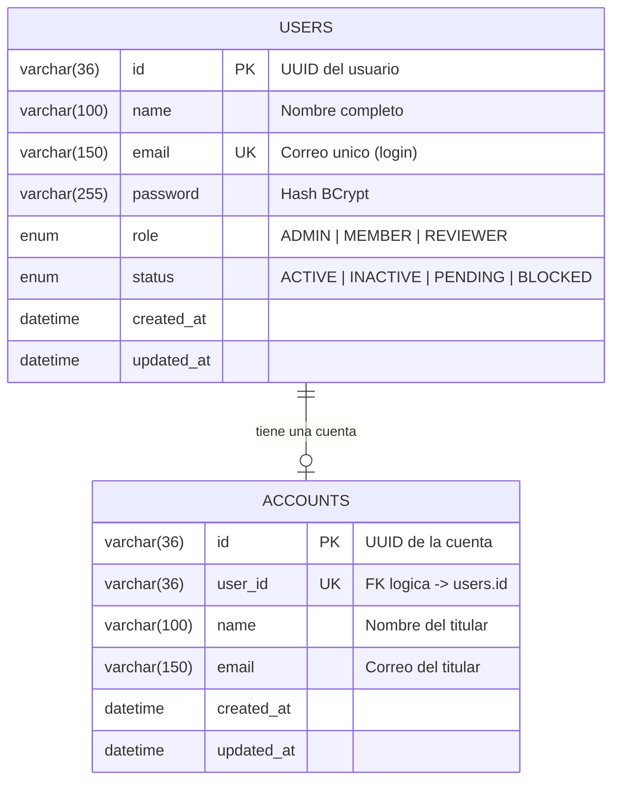

# Esquema de la base de datos

Base de datos **MySQL/TiDB compartida** por los microservicios `users` (pasos 1, 2, 5) y
`accounts` (paso 6). El script que la crea vive en
[`users/src/main/resources/schema.sql`](../users/src/main/resources/schema.sql).

| Dato | Valor |
|---|---|
| Motor | MySQL 8.4 (local) / TiDB (producción) |
| Base de datos | `crud_usuarios` |
| Charset / collation | `utf8mb4` / `utf8mb4_unicode_ci` |
| Motor de tablas | `InnoDB` |
| Tablas | `users`, `accounts` |

## Diagrama entidad-relación



> La relación `users (1) — (0..1) accounts` es **lógica**: cada usuario tiene como máximo una
> cuenta, pero se garantiza con el índice `UNIQUE (user_id)` en `accounts`, no con una clave
> foránea física (los servicios están desacoplados y comparten la base por conveniencia).

## Tabla `users`

Gestionada por el microservicio **users**.

| Columna | Tipo | Nulo | Default | Descripción |
|---|---|---|---|---|
| `id` | `VARCHAR(36)` | No | — | **PK**. UUID del usuario. |
| `name` | `VARCHAR(100)` | No | — | Nombre del usuario. |
| `email` | `VARCHAR(150)` | No | — | **UNIQUE**. Correo usado para login. |
| `password` | `VARCHAR(255)` | No | — | Contraseña hasheada con BCrypt. |
| `role` | `ENUM` | No | — | `ADMIN`, `MEMBER`, `REVIEWER`. |
| `status` | `ENUM` | No | `PENDING` | `ACTIVE`, `INACTIVE`, `PENDING`, `BLOCKED`. |
| `created_at` | `DATETIME` | No | `CURRENT_TIMESTAMP` | Fecha de creación. |
| `updated_at` | `DATETIME` | No | `CURRENT_TIMESTAMP` `ON UPDATE CURRENT_TIMESTAMP` | Última modificación. |

**Índices y restricciones**

- `PRIMARY KEY (id)`
- `UNIQUE (email)`

## Tabla `accounts`

Gestionada por el microservicio **accounts** (paso 6 del diagrama). La operación de alta es
**idempotente**: si `users` reintenta la llamada, se devuelve la cuenta existente en lugar de
duplicarla (se apoya en el `UNIQUE (user_id)`).

| Columna | Tipo | Nulo | Default | Descripción |
|---|---|---|---|---|
| `id` | `VARCHAR(36)` | No | — | **PK**. UUID de la cuenta. |
| `user_id` | `VARCHAR(36)` | No | — | **UNIQUE**. Id del usuario en `users`. |
| `name` | `VARCHAR(100)` | No | — | Nombre del titular. |
| `email` | `VARCHAR(150)` | No | — | Correo del titular. |
| `created_at` | `DATETIME` | No | `CURRENT_TIMESTAMP` | Fecha de creación. |
| `updated_at` | `DATETIME` | No | `CURRENT_TIMESTAMP` `ON UPDATE CURRENT_TIMESTAMP` | Última modificación. |

**Índices y restricciones**

- `PRIMARY KEY (id)`
- `UNIQUE (user_id)`

## Valores de los ENUM

| Enum | Tabla | Valores |
|---|---|---|
| `role` | `users` | `ADMIN`, `MEMBER`, `REVIEWER` |
| `status` | `users` | `ACTIVE`, `INACTIVE`, `PENDING`, `BLOCKED` |

## DDL completo

```sql
CREATE DATABASE IF NOT EXISTS crud_usuarios
    CHARACTER SET utf8mb4
    COLLATE utf8mb4_unicode_ci;

USE crud_usuarios;

CREATE TABLE IF NOT EXISTS users (
    id          VARCHAR(36)  NOT NULL PRIMARY KEY,
    name        VARCHAR(100) NOT NULL,
    email       VARCHAR(150) NOT NULL UNIQUE,
    password    VARCHAR(255) NOT NULL,
    role        ENUM('ADMIN', 'MEMBER', 'REVIEWER') NOT NULL,
    status      ENUM('ACTIVE', 'INACTIVE', 'PENDING', 'BLOCKED') NOT NULL DEFAULT 'PENDING',
    created_at  DATETIME NOT NULL DEFAULT CURRENT_TIMESTAMP,
    updated_at  DATETIME NOT NULL DEFAULT CURRENT_TIMESTAMP ON UPDATE CURRENT_TIMESTAMP
) ENGINE=InnoDB DEFAULT CHARSET=utf8mb4 COLLATE=utf8mb4_unicode_ci;

CREATE TABLE IF NOT EXISTS accounts (
    id          VARCHAR(36)  NOT NULL PRIMARY KEY,
    user_id     VARCHAR(36)  NOT NULL UNIQUE,
    name        VARCHAR(100) NOT NULL,
    email       VARCHAR(150) NOT NULL,
    created_at  DATETIME NOT NULL DEFAULT CURRENT_TIMESTAMP,
    updated_at  DATETIME NOT NULL DEFAULT CURRENT_TIMESTAMP ON UPDATE CURRENT_TIMESTAMP
) ENGINE=InnoDB DEFAULT CHARSET=utf8mb4 COLLATE=utf8mb4_unicode_ci;
```

## Datos semilla

El script inserta un usuario administrador inicial:

| Campo | Valor |
|---|---|
| `id` | `00000000-0000-0000-0000-000000000001` |
| `name` | `Administrador` |
| `email` | `admin@example.com` |
| `password` | `Admin1234!` (almacenada como hash BCrypt) |
| `role` | `ADMIN` |
| `status` | `ACTIVE` |

## Cómo se carga el esquema

- **Local (`docker compose up`)**: MySQL ejecuta `schema.sql` automáticamente al inicializar el
  volumen, mediante el montaje
  `./users/src/main/resources/schema.sql:/docker-entrypoint-initdb.d/001-schema.sql`.
- **Render / producción**: ejecutar `users/src/main/resources/schema.sql` **una vez** contra la
  instancia de MySQL/TiDB (ver README, sección *Despliegue en Render*).
